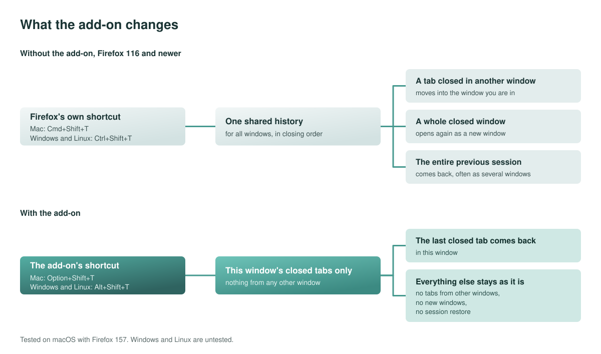

<p align="center"></p>

# Per-Window Undo Close Tab

A Firefox add-on. It reopens the tab you closed last in the window you are working in. It never reopens tabs from other windows and never opens extra windows.



## Why

Until Firefox 115, "reopen closed tab" worked per window. In newer versions it works across all windows. A tab you closed in window B can show up in window A. The same command can also reopen a whole closed window or all windows of your previous Firefox session.

This add-on brings the per-window behavior back as its own command.

## Install

[Per-Window Undo Close Tab on Firefox Add-ons](https://addons.mozilla.org/firefox/addon/per-window-undo-close-tab/)

To try the source instead, open `about:debugging#/runtime/this-firefox`, click **Load Temporary Add-on…** and choose `extension/manifest.json`. Firefox removes a temporary add-on when it quits.

Requires Firefox 140 or newer. Tested on macOS with Firefox 157. Windows and Linux are untested.

## Use it

Press the shortcut in the window where you closed the tab:

- Mac: `Option`+`Shift`+`T`
- Windows and Linux: `Alt`+`Shift`+`T`

To change the shortcut, open `about:addons`, click the gear icon and choose **Manage Extension Shortcuts**.

## Use Firefox's own keys

Firefox's own shortcut for reopening a tab is:

- Mac: `Cmd`+`Shift`+`T`
- Windows and Linux: `Ctrl`+`Shift`+`T`

It wins over the add-on. To use these keys for the add-on, remove Firefox's shortcut:

1. Type `about:keyboard` into the address bar.
2. Search for *closed*.
3. Click the **×** next to **Reopen Last Closed Tab**.

The add-on now uses the same keys automatically.

## Closed windows

The add-on reopens tabs. To reopen a closed window, use Firefox's own command:

- Mac: `Cmd`+`Shift`+`N`
- Windows and Linux: `Ctrl`+`Shift`+`N`

Or choose **History → Recently Closed Windows**. The window opens with its open tabs. Tabs you had already closed in it stay available there. Reopen them with this add-on.

## Keep closed tabs for longer (optional)

You do not need this to use the add-on. Firefox keeps 5 closed windows and 25 closed tabs per window, and forgets them after 14 days. Only if you want it to remember more, follow [docs/optional-settings.md](docs/optional-settings.md). The sliders on the add-on's settings page do not change Firefox. They show the value to enter in `about:config`.

## How it works

The add-on asks Firefox for the list of closed tabs and reopens the newest one that was closed in the current window. It saves only the slider positions of its settings page, on your computer.

## Privacy

No data is collected and nothing is sent anywhere. The add-on has one permission, `sessions`: it reads the closed tabs and reopens one.

## Development

```sh
./scripts/build.sh                        # dist/per-window-undo-close-tab-<version>.zip
./scripts/make-icons.sh                   # icon.svg and the PNG sizes
./scripts/make-diagram.py                 # the diagram in docs/img
npx web-ext lint --source-dir extension   # static checks
npx web-ext run --source-dir extension    # start Firefox with the add-on loaded
```

There is no bundler and no dependency. The files in `extension/` are what ships.

## License

MIT, see [LICENSE](LICENSE).
