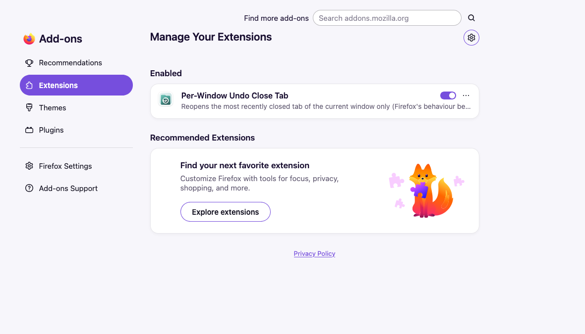
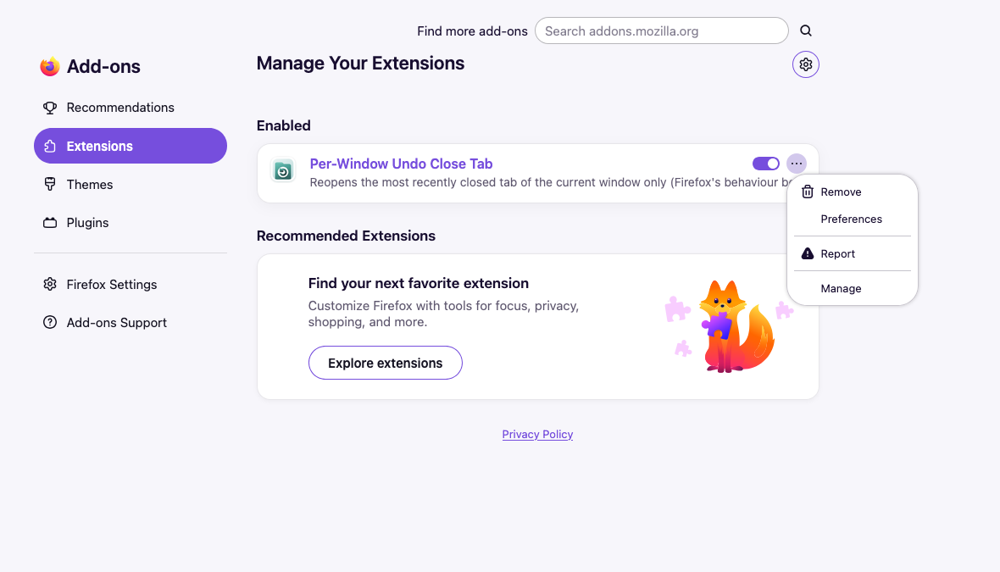
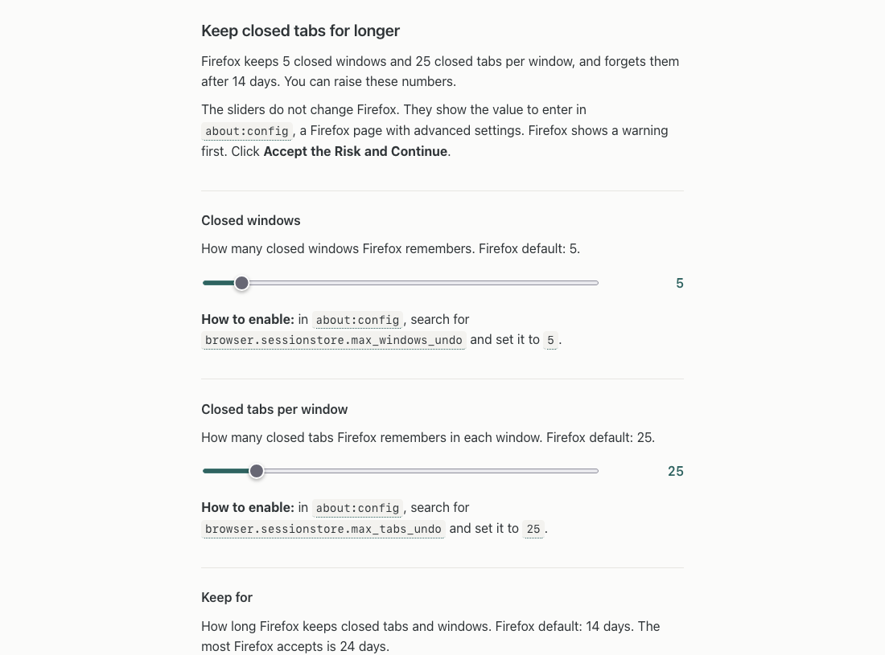

# Keep closed tabs for longer (optional)

You do not need this to use the add-on. Firefox keeps 5 closed windows and 25 closed tabs per window, and forgets them after 14 days. To bring back a window days later, raise these numbers.

Firefox does not let add-ons change them. The add-on's settings page shows the value to enter for each setting, and you enter it in `about:config`.

## 1. Open the settings page

Open `about:addons`, click the **…** button next to the add-on and choose **Preferences**.

## 2. Move a slider

Each setting has its own block with a slider and a line that starts with **How to enable**. The line shows the setting name and the value to enter.

| Setting | Slider range | Firefox default |
|---|---|---|
| `browser.sessionstore.max_windows_undo` | 1 to 50 windows | 5 |
| `browser.sessionstore.max_tabs_undo` | 1 to 200 tabs per window | 25 |
| `browser.sessionstore.cleanup.forget_closed_after` | 1 to 24 days | 14 days |

## 3. Enter the value in about:config

1. Type `about:config` into the address bar and click **Accept the Risk and Continue**.
2. Search for the setting name, click the pencil, type the value and press Enter.

Do the same for each setting you want to change.
